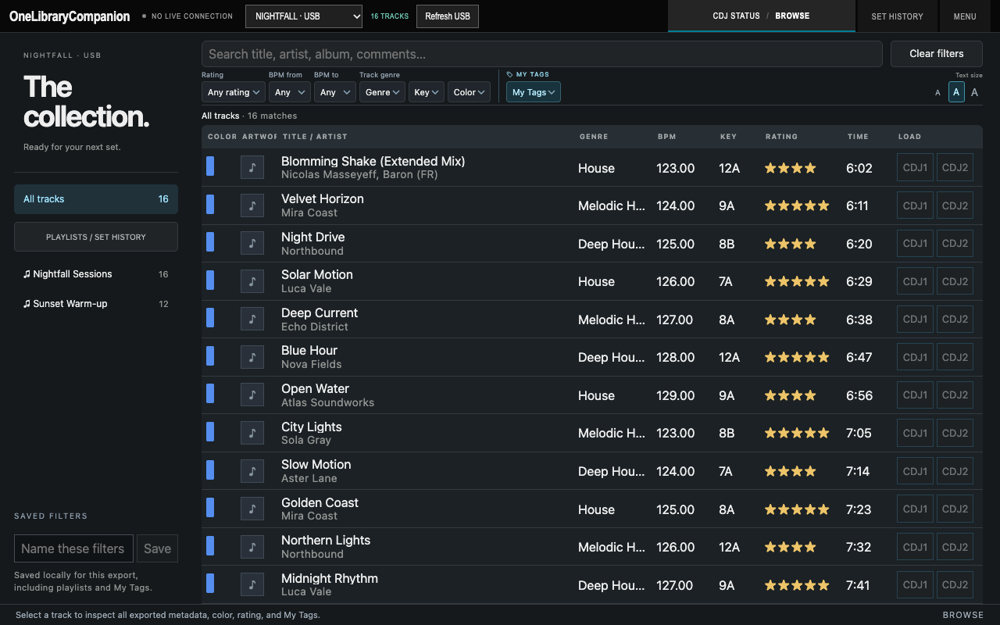
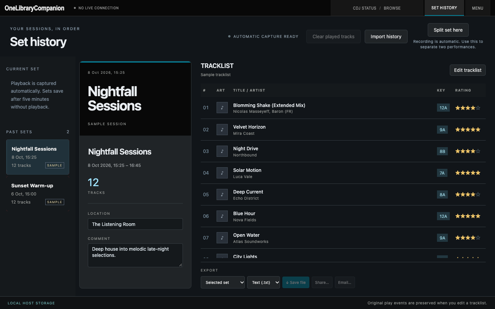

# OneLibraryCompanion (OLC)

Browse your rekordbox libraries, follow two CDJs and keep a record of your sets.
OLC runs on a Mac or Raspberry Pi and shares its interface with browsers on the
same network. Playback, cueing and mixing stay on your CDJs.

[Download OLC](https://github.com/hdelplan/OneLibraryCompanion/releases) ·
[Installation](docs/distribution.md) · [Using OLC](docs/screenshots.md) ·
[0.5.0 release notes](docs/release-notes.md)

## Features

- **Follow the mix:** live three-band waveforms, track overviews, BPM, pitch,
  key, master/sync status, exported beats, phrases, cues and loops.
- **Find your next track:** browse USB libraries and playlists; search, sort,
  combine metadata and My Tag filters, and save filter presets. Harmonic key
  highlighting and played-track marks help with selection.
- **Preview tracks:** listen through the browser or desktop window before
  loading a player, with artwork, waveforms and seeking.
- **Load either deck:** send a track to a stopped CDJ from a player-mounted USB
  or a OneLibrary USB attached to the Mac/Pi. Both decks can use the same local
  library. Compatible originals remain unchanged; built-in transcoding prepares
  eligible unsupported audio as WAV or AIFF.
- **Record and reuse sets:** capture tracklists automatically, edit saved sets,
  import supported rekordbox histories, browse past sets as playlists, and export
  text, CSV or PDF.
- **Manage CDJ settings:** import saved My Settings, edit reusable profiles,
  push them to stopped CDJ-2000nexus players, and optionally apply profiles on
  connection.
- **Adjust the display:** automatic sizing, resolution presets, stacked or
  extra-wide side-by-side decks, beat-phase/reference-waveform comparisons,
  configurable filters and track-list sizes.

*Screenshots illustrate active sessions; connection and playback states are illustrative.*

## Get started

Use **macOS 13+** on Apple Silicon or Intel, or a **Raspberry Pi 4/5 with
64-bit Raspberry Pi OS Bookworm or later**.

1. Install OLC and connect the host and CDJs to the same local network.
2. Select the CDJ network connection in MENU. Use physical player numbers 1 and 2;
   leave number 4 free for OLC when serving a local USB.
3. Select a library in BROWSE. Stop the destination player, then press **CDJ1** or
   **CDJ2** to load a track. Mac local USB serving requires the included
   **Local USB Support** installation.
4. Keep OLC running and the music USB attached during playback. For a remote
   screen, open the network address shown in MENU.

A Pi can start without a monitor or desktop login. Follow the
[headless setup](docs/distribution.md#raspberry-pi-headless).

## Guides and limits

[Display and filters](docs/configuration.md) ·
[Local USB and transcoding](docs/local-usb.md) ·
[Set history](docs/set-history.md) ·
[CDJ configuration profiles](docs/cdj-configurations.md)

Fine waveform tracking is limited on a paused non-master player; use the CDJ's
own display and audio for precise cueing. One local USB library is served per
connection session. Platform/model coverage and other current limits are listed
in [compatibility](docs/compatibility.md).

For contributors: [Build and checks](docs/development.md) ·
[Architecture](docs/architecture.md) · [Hardware verification](docs/hardware-testing.md).

## License

OLC is GPL-3.0-only and independent of Pioneer DJ, AlphaTheta and rekordbox.
See [acknowledgments](THIRD_PARTY_NOTICES.md) and
[source credits](third-party-licenses/SOURCE-CREDITS.md).
